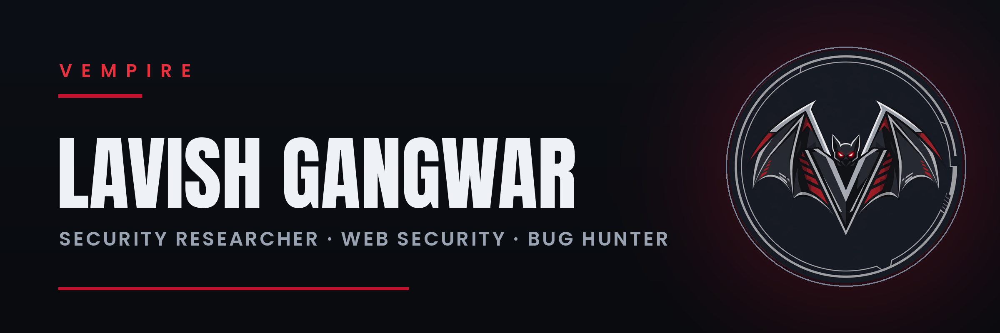
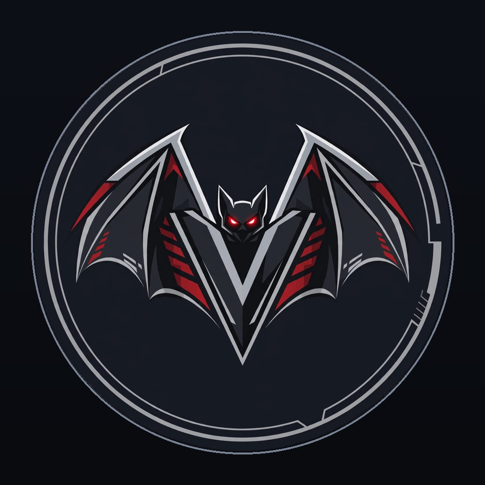
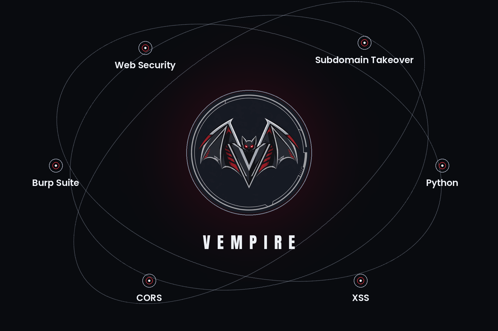
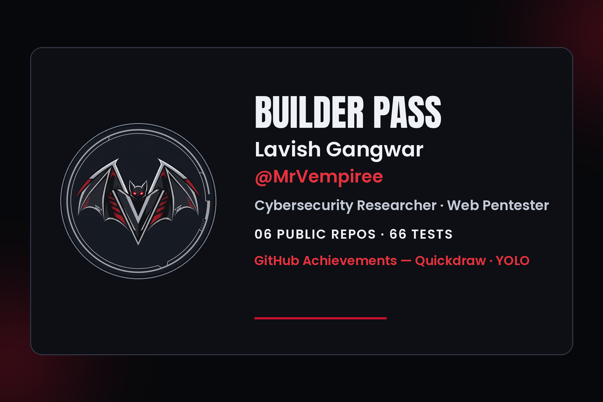

### LAVISH GANGWAR

**Cybersecurity Researcher · Web Pentester · Security Automation**

I test web applications against the OWASP Top 10 — and build the open-source tools that automate the checks: CORS trust flaws, dangling DNS and subdomain takeover, XSS. Every finding reproduced and evidenced before it is reported.

💻 [GitHub](https://github.com/MrVempiree) · 💼 [LinkedIn](https://www.linkedin.com/in/mrvempiree)

---

### 01 / FROM THOUGHT TO THING

```
$ scan()

recon → test → verify → report
```

**THINK** — Map the trust boundaries first: origins, DNS records, input points.
**EXECUTE** — Test methodically, and capture the evidence — not just the claim.
**BUILD** — Automate the check into a tested tool, so it never gets skipped.

- CORS misconfigurations
- Subdomain takeover & dangling DNS
- XSS automation
- OWASP Top 10 web flaws

### 02 / LIFE OUTSIDE THE COMMIT


1. **Building security tools** — zero-dependency Python scanners, each shipped with a real test suite and CI.
2. **Web security labs** — hands-on practice material for the flaws I hunt, in web-security-labs.
3. **Open-source collaboration** — trading pull requests, reviews and fixes with fellow researchers.

**BELIEF** — A finding isn't real until it's reproduced, evidenced and written down.

---


---

## 03 / MY ONLINE ROOM



**Languages**


**Security Toolkit**

 

**Workflow & Platforms**

 

---

## THINGS I'VE BUILT

| Project | What it does | Focus |
| --- | --- | --- |
| [cors-hunter](https://github.com/MrVempiree/cors-hunter) | CORS misconfiguration scanner — reflected origins, trusted `null`, wildcard-with-credentials, preflight flaws, each with evidence and a fix | Python · CORS · browser trust |
| [takeover-check](https://github.com/MrVempiree/takeover-check) | Subdomain takeover checker — dangling CNAMEs matched against 15 service fingerprints, classified with evidence | Python · DNS · subdomain takeover |
| [web-security-labs](https://github.com/MrVempiree/web-security-labs) | Hands-on web security labs for practising the OWASP Top 10 | Web security · labs |

---

## REAL WORK. REAL IMPACT.



| 06 | 66 | 02 |
| --- | --- | --- |
| **PUBLIC REPOSITORIES** — open source on GitHub | **TESTS** — across cors-hunter & takeover-check | **ACHIEVEMENTS** — Quickdraw + YOLO, live |

- **GitHub achievements** — Quickdraw and YOLO earned and visible on this profile.
- **Open-source contributor** — pull request adding CVE-2020-36170 (Ultimate Member) to the [wp-cve-hunter](https://github.com/gravion-ux/wp-cve-hunter) CVE dataset.
- **Tooling author** — both flagship tools are zero-dependency Python, fully unit-tested offline, with terminal, JSON and Markdown reporting.

**CORE CRAFT**

```
Web application pentesting  ████████████████████
CORS & browser trust flaws  ████████████████████
Subdomain takeover & DNS    ████████████████████
XSS automation              ████████████████████
```

*Bars mark focus areas, not scores.*

---

## LET'S CONNECT.

### BUILD SOMETHING GREAT.

|  |  |
| --- | --- |
| 💻 GitHub | [@MrVempiree](https://github.com/MrVempiree) |
| 💼 LinkedIn | [mrvempiree](https://www.linkedin.com/in/mrvempiree) |
| 🌍 Based in | India · Open to remote work |

---

*Test. Verify. Report.*
